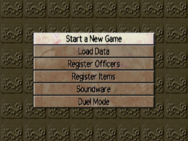
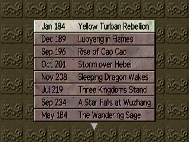
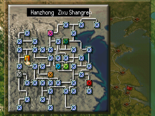
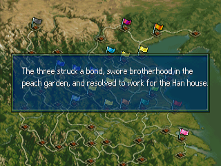
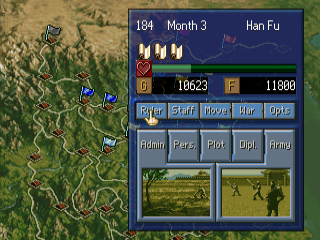
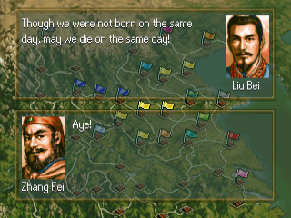
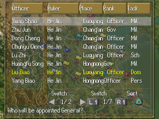
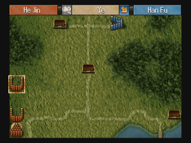
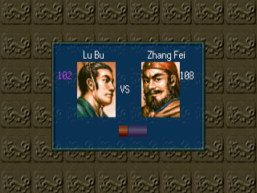

# Sangokushi V with Power-Up Kit — English Translation

A fan translation of **Sangokushi V with Power-Up Kit** (三國志V with パワーアップキット, Koei, 1998)
for the PlayStation into English. *Sangokushi V* is the fifth *Romance of the Three Kingdoms*:
you rule a force in 2nd–3rd century China, govern your cities, recruit officers and fight hex-map
battles to unify the land. The Power-Up Kit edition adds new scenarios, an officer and item
editor, a duel and tournament mode and more. It was only released in Japan.

> **This is a full machine translation.** All of the game's text was translated from
> Japanese by an AI model, not by a human translator, and it has not been
> proofread by a fluent Japanese speaker. Expect occasional mistranslations, awkward
> phrasing and inconsistent terms. Corrections are welcome. Officer names, places and
> game terms follow the English translation of *Sangokushi DS 3* (a port of this game,
> also a fan machine translation by the same author).

> **This is a beta (v0.9.0).** All of the game's text is in English and the main screens
> have been played through, but not every battle screen and event has been seen yet.
> Expect some text that is squeezed, cut short or wrapped oddly.

This repository contains the English text and the tools that build the patch.
It does **not** contain the game, any of its data, or the Japanese script — you need
your own copy of the game.

## Screenshots

| | | |
|:-:|:-:|:-:|
|  |  |  |
| Main menu | Scenario select | Ruler select |
|  |  |  |
| Historical event | Strategy map | Dialogue |
|  |  |  |
| Officer list | Battle | Duel tournament |

## What's translated

- All of the game's message text: advisor reports, diplomacy and plots, war and duel
  messages, historical events (including the Power-Up Kit's), scenario introductions,
  letters, the tutorial and memory card messages
- All officer biographies
- Menus, labels, buttons and system messages, including the officer and item editors and
  the duel and tournament screens
- 500 officers, 47 cities, titles, items and formations, romanised
- Graphics: title logo, main menu and scenario list, command and panel buttons, stat labels,
  ruler-select button, duel and tournament captions, redrawn at build time with an original
  English font
- A proportional English font (original drawings) with word wrap and self-sizing windows
- **English name entry**: new officers and items are named with letter grids (A–Z, a–z,
  digits, ’ - . and space); the screen opens on the Japanese grid as in the original — press
  Left to reach the mode buttons

Long names and labels are shortened where the game's boxes are too small.

## Applying the patch (players)

1. Download the release zip (`Sangokushi_V_PUK_English_v<version>.zip`) from the Releases
   page. It contains the patch `sangokushi_5_puk_en_v<version>.xdelta`, a `.cue` file and
   a README.txt.
2. You need an unmodified image of the Japanese disc (serial `SLPS-01466`) in the usual
   eight-track BIN/CUE form (Redump). Only track 1 is patched:

   | Track 1 | |
   |---|---|
   | Size  | 413,321,664 bytes |
   | CRC32 | `CC5BC87E` |
   | MD5   | `a150fa5aa856c4381e668db30142da52` |
   | SHA-1 | `74744d56f1f5ac9fe80696a052df1776b026e97e` |

   Tracks 2-8 (CD audio) are used unchanged; their checksums are in the zip's README.txt.
3. Apply the patch to track 1 with an xdelta tool, e.g.
   [Delta Patcher](https://github.com/marco-calautti/DeltaPatcher) or the command line:

   ```
   xdelta3 -d -s "Sangokushi V with Power-Up Kit (Japan) (Track 1).bin" sangokushi_5_puk_en_v<version>.xdelta "Sangokushi V with Power-Up Kit (English v<version>) (Track 1).bin"
   ```

4. Put the zip's `Sangokushi V with Power-Up Kit (English v<version>).cue` next to the patched
   track 1 and the original tracks 2-8, and open the `.cue` in your emulator.

The patched disc has the same serial, so it uses the same memory card saves as the
Japanese game.

## Building from source

Requirements: Python 3.10+, `xdelta3` (for the patch file).

```
python -m venv .venv
.venv/bin/pip install -r requirements.txt
for n in 1 2 3 4 5 6 7 8; do
  cp "/path/to/Sangokushi V with Power-Up Kit (Japan) (Track $n).bin" sangokushi_5_puk_track$n.bin
done
.venv/bin/python tools/setup.py      # checks the disc, extracts script/ from it
.venv/bin/python tools/build.py      # writes build/sangokushi_5_puk_en_track1.bin (+ tracks 2-8, .cue) and the .xdelta
```

`tools/setup.py` checks the disc's SHA-1 and generates `script/`, the Japanese text
from your disc. `script/` and `build/` are never committed.
The build is reproducible: the same disc and sources give a byte-identical patch.

To make a release package, run `.venv/bin/python tools/package.py 0.9.0` after building:
it writes `release/Sangokushi_V_PUK_English_v0.9.0.zip` with the versioned xdelta patch,
the `.cue` and a plain-text README.txt. No disc data is ever packaged.

## Repository layout

| Path | Contents |
|---|---|
| `tl/msg/` | English for the message file `MESSAGE/MESSAGE.BIN`, one file per block, by message number |
| `tl/progstr/` | English for strings in the game program, by address |
| `tl/names/` | English names: officers, cities, titles, items, formations |
| `tl/gfx.txt` | Text drawn into graphics |
| `tools/setup.py`, `tools/build.py` | Create `script/`; build the patched disc and the patch |
| `tools/tl.py` | Validates translations and estimates line counts (`apply`, `show`, `check`, `stats`) |
| `tools/iso.py`, `msgfile.py`, `text.py` | Disc image (ISO 9660, EDC/ECC), message file and text formats |
| `tools/progstr.py`, `layout.py`, `fmtlimit.py` | Program strings, layout fixes, buffer limits for format strings |
| `tools/kanji.py`, `vwf.py`, `pixfont.py` | Frees the kanji font's RAM; proportional font (original drawings) and word wrap |
| `tools/names.py`, `namedict.py`, `nameentry.py` | English names in the game, English name entry |
| `tools/gfx.py`, `latinfont.py`, `tinyfont.py` | Redrawn graphics and the fonts for them |
| `tools/asm.py` | Small MIPS assembler for the program patches |
| `tools/package.py` | Makes the release zip (patch + .cue + README.txt with checksums) |
| `tools/dev/`, `tools/emu/` | Development helpers (disassembly, DuckStation automation) |

## Known issues

- The movies are unchanged (not checked for on-screen Japanese text).
- Battles have been checked from the war confirmation to the unit cards, but no battle
  has been played to the end yet.
- Name entry opens on the Japanese kana grid; picking a kana there leads to an empty kanji
  list (press × to go back). Use the A–Z / a–z buttons on the left.
- New officer names hold up to 8 letters, item names up to 12.
- Some labels are squeezed to fit narrow boxes, and many are abbreviated.

Tested in DuckStation only. Bug reports with a screenshot and where it happened are welcome.

## Credits

- Translation and hacking: [damon-daemon](https://github.com/damon-daemon)
- Sangokushi V with Power-Up Kit © Koei Tecmo. This is an unofficial fan project, not
  affiliated with or endorsed by Koei Tecmo. Please support the official releases.

## License

The tools, fonts, documentation and English translation text in this repository
are released under the [MIT License](LICENSE). This covers only original work in
this repository: the game itself and all of its content (code, Japanese text,
graphics, audio) are copyright Koei Tecmo and are not included or licensed here.
